<!-- Harvest Fleet AI README. Art lives in docs/readme/ (hand-written SVG, no scripts or external fonts). -->

<div align="center">



<br/>

**An AI that runs a citrus farm's fleet of autonomous tractors.** It plans the day's jobs, re-plans in milliseconds when something breaks, and explains every decision.

<br/>


[](backend/README.md)
[](backend/README.md)
[](dashboard/)
[](dashboard/)
[](agopenweb-bridge/README.md)

<br/>

[Features](#features) &nbsp;·&nbsp; [Architecture](#architecture) &nbsp;·&nbsp; [Quick start](#quick-start) &nbsp;·&nbsp; [Honesty notes](#honesty-notes)

</div>


Built for the **AgX Arizona Summit Hackathon**, challenge **"Run the Fleet"**, by **Divi** (dashboard), **Anay** (platform, FastAPI, AgOpenWeb) and **Diya** (planner).

## Features



- 🧠 **Coordinator agents.** A fleet planner checks implements, fuel and deadlines; **Safety** validates every plan; plus Navigation, Weather, Agronomy, Mechanic and **"Why?"** counterfactuals.
- 🔧 **Breakdown recovery.** Unfinished work is re-planned (167 ms for the scripted breakdown) and a reassigned job **keeps its progress**.
- 🗺️ **3D diorama + satellite Map.** A three.js farm, and real USGS NAIP imagery of Mesa citrus groves with AgOpenGPS-style overlays.
- 🚜 **Real AgOpenWeb tractors.** The bridge drives headless AgOpenWeb (the AgOpenGPS rewrite) in Docker, with a hot-seat mode.
- 🕹️ **Tractor cockpit.** Manual drive, AB lines, **Drive this line**, sections, and a preview before any change that re-plans.
- ✨ **AI Supervisor.** An LLM reviews plans, implements and plots (vision on satellite crops) and **proposes**; the operator approves; Safety validates. It can also reword explanations, and a validator rejects any changed fact.
- 📊 **Mock | Live + honest scorecard.** One switch between the in-browser simulation and a real backend, scored against a first-come, first-served baseline.

## Architecture

```
dashboard (Vite + three.js) ── data layer: Mock (in-browser) | Live (REST + /ws)
                                   ├── backend/           FastAPI + planner        :8000  (the scored coordinator)
                                   ├── mock-backend/      simulated backup         :8001
                                   └── agopenweb-bridge/  ──► AgOpenWeb containers :8040  (Docker)
ai-supervisor (:8060) ◄──► LLM provider (agy now; OpenAI / Anthropic via env keys)
```

All backends speak one contract ([ARCHITECTURE.md](ARCHITECTURE.md)), so switching is a URL setting.

## Quick start

```sh
# planner backend (repo root; Windows: .venv/Scripts/python)
python -m venv .venv && .venv/bin/python -m pip install -r backend/requirements.txt
cd backend && HFA_MAX_TRACTORS=5 ../.venv/bin/python -m uvicorn app.main:app --host 0.0.0.0 --port 8000

# dashboard (second terminal)
cd dashboard && npm install && npx vite
```

- **Mock:** `http://localhost:5173/?source=mock` (no server, every feature on)
- **Live:** `http://localhost:5173/?source=live&api=http://localhost:8000`, then press Play
- **AgOpenWeb bridge:** `&api=http://localhost:8040` after `MAX_TRACTORS=3 REAL_SLOTS=3 node agopenweb-bridge/server.mjs`
- **AI Supervisor:** add `&ai=http://localhost:8060` after `AI_PROVIDER=agy API=http://localhost:8000 node ai-supervisor/server.mjs` (or `openai`, `anthropic`, `rules`)

<details>
<summary><b>Tests</b></summary>

<br/>

```sh
scripts/verify.sh <commit>                                   # build, node tests, mock-backend smoke, bridge tests
API=http://localhost:8000 node scripts/coldstart-e2e.mjs     # against a freshly started planner backend
PYTHONPATH=backend .venv/bin/python -m unittest discover -s backend/tests/brain -v
cd ai-supervisor && npm test
```

</details>

**More:** [DEMO.md](DEMO.md) · `SCENARIOS.md` (on the `scenarios` branch) · [backend/README.md](backend/README.md) · [INTEGRATION_REPORT.md](INTEGRATION_REPORT.md)

## Honesty notes

- Mock is a simulation, and so is its baseline. Only the planner backend's scorecard is measured.
- The bridge's travel, idle and violation numbers are placeholders. It skips the Python planner.
- On the planner backend, weather is a placeholder; Weather, Agronomy, Mechanic, "Why?" and the cockpit run in Mock and mock-backend.
- Known open issues: rows 14 and 15 in [INTEGRATION_REPORT.md](INTEGRATION_REPORT.md).

## Acknowledgements

[AgOpenGPS](https://github.com/AgOpenGPS-Official) and AgOpenWeb · imagery: USGS The National Map / NAIP (public domain) · [three.js](https://threejs.org)
